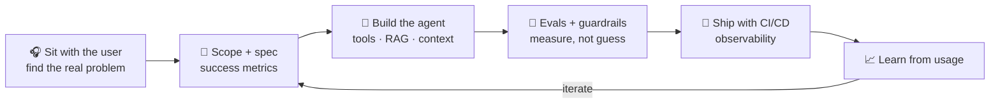
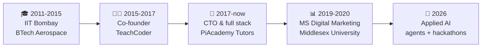
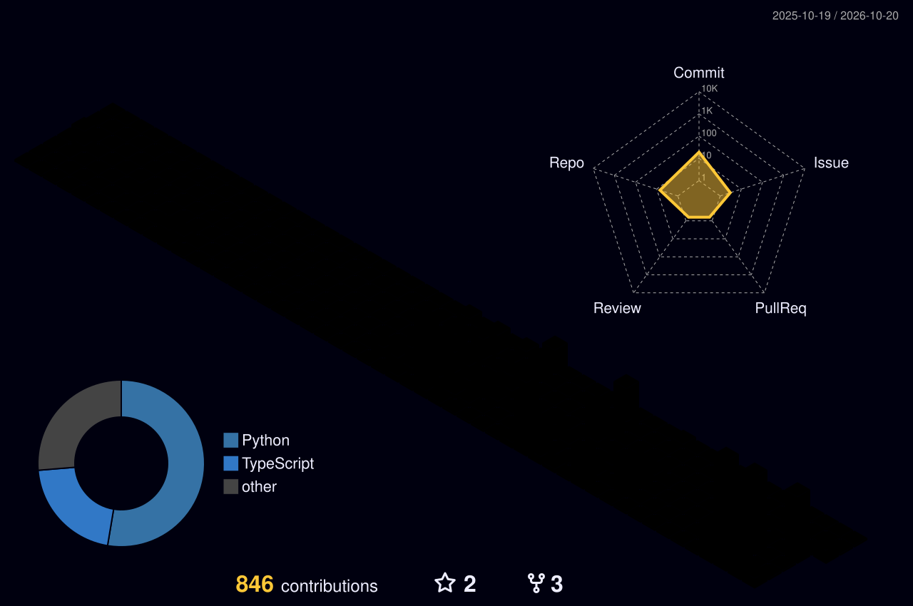

<div align="center">


<a href="https://github.com/Dinesh-Sunny">
  
</a>

<p>
  <a href="https://dinesh-potluru.vercel.app"></a>
  <a href="https://www.linkedin.com/in/dinesh-potluru-a967866a"></a>
  <a href="https://twitter.com/_dineshsunny"></a>
  <a href="mailto:dineshiitb.ae18@gmail.com"></a>
</p>
<p>
  
  
  
</p>

</div>

---

## 👋 About me

```ts
const dinesh = {
  role:      "Applied AI / Forward Deployed Engineer",
  today:     "CTO & full stack engineer at PiAcademy Tutors (edtech, London) since 2017",
  focus:     ["AI agents in production", "RAG", "evals", "context engineering", "developer experience"],
  stack:     ["TypeScript", "Next.js", "React", "Node.js", "Python", "PostgreSQL", "Redis"],
  education: ["IIT Bombay - BTech Aerospace", "Middlesex University - MS Digital Marketing"],
  offline:   ["competitive badminton 🏸", "daily yoga 🧘", "teaching maths 📐"],
  motto:     "Sit with the customer, find the real problem, ship the agent that fixes it.",
};
```

- 🧠 I take messy, real-world problems and turn them into **AI systems people actually use** - internal tools and customer-facing products
- 🏗️ Years of **end-to-end product engineering**: architecture, data, frontend, infra, team leadership
- 🏆 Regular at **London AI hackathons** - idea to working demo in a weekend
- 🤝 **Open to** Applied AI, Forward Deployed, AI Solutions and Founding AI Engineer roles

---

## 🛠️ Tech stack

<div align="center">

**Languages**<br/>


**Frontend**<br/>


**Backend and data**<br/>


**Cloud and tooling**<br/>


**AI and agents**<br/>


</div>

---

## 🚀 Featured projects

<div align="center">
  <a href="https://github.com/Dinesh-Sunny/sixthsense"></a>
  <a href="https://github.com/Dinesh-Sunny/jev-tokensaver"></a>
  <a href="https://github.com/Dinesh-Sunny/superteams"></a>
  <a href="https://github.com/Dinesh-Sunny/nextjs-agent-starter"></a>
</div>

| Project | The problem it solves | Stack |
|---|---|---|
| 🚌 **[SixthSense](https://github.com/Dinesh-Sunny/sixthsense)** | *"Every London bus, a second pair of eyes."* A video agent that predicts what happens next on bus CCTV, grades its own prediction against the next clip and flags near misses for safety teams. Built at the VAST Video Agents Hack, London. | Python · FastAPI · Next.js · YOLO11 · ByteTrack · NVIDIA Cosmos |
| ✂️ **[Jev Token Saver](https://github.com/Dinesh-Sunny/jev-tokensaver)** | AI coding agents waste tokens reading huge logs and files. Jev pre-reads them and hands the agent only the relevant lines - prune, find, rank, map. Fail-open and secrets-scrubbed. | Python · MCP · CLI |
| 👥 **[Superteams](https://github.com/Dinesh-Sunny/superteams)** | Small agencies juggle clients, tasks and notes across too many tools. One multi-tenant workspace with AI agents built in. | Next.js · TypeScript |
| ⚡ **[Next.js Agent Starter](https://github.com/Dinesh-Sunny/nextjs-agent-starter)** | Every new agent app starts with the same boilerplate. A Next.js 16 + React 19 starter with agent scaffolding, secrets management and provider switching. | Next.js · TypeScript · Tailwind |
| 🧰 **[Claude project starter](https://github.com/Dinesh-Sunny/new-app)** | A repo template with a full Claude Code setup and a self-maintaining AI-context system, so agents understand a codebase from day one. | Claude Code · pnpm · uv |

<sub>More of my work (agency tooling, trading research, education products) lives in private repositories - happy to walk through it on a call.</sub>

---

## 🧭 How I ship AI to customers



---

## 🛤️ Journey



---

## 📊 GitHub stats

<div align="center">





</div>

### 🏙️ Contributions in 3D

<picture>
  <source media="(prefers-color-scheme: dark)" srcset="./profile-3d-contrib/profile-night-rainbow.svg" />
  <source media="(prefers-color-scheme: light)" srcset="./profile-3d-contrib/profile-green-animate.svg" />
  
</picture>

### 🐍 Contribution snake

<div align="center">
  <picture>
    <source media="(prefers-color-scheme: dark)" srcset="https://raw.githubusercontent.com/Dinesh-Sunny/Dinesh-Sunny/output/github-snake-dark.svg" />
    <source media="(prefers-color-scheme: light)" srcset="https://raw.githubusercontent.com/Dinesh-Sunny/Dinesh-Sunny/output/github-snake.svg" />
    
  </picture>
</div>

---

## ⚡ Recent activity

<!--START_SECTION:activity-->
1. ⬆️ Pushed to [sixthsense](https://github.com/Dinesh-Sunny/sixthsense) <sub>· 17 Oct 2026</sub>
<!--END_SECTION:activity-->

<sub>Auto-updated every few hours by GitHub Actions.</sub>

---

## 🎯 Right now

- 🔭 Building **agentic dev workflows** - teams of AI agents that plan, code, review and ship
- 🎥 Exploring **video agents**, **voice AI agents at scale** and **AI filmmaking pipelines**
- 💬 Ask me about: putting agents into production, RAG and evals, Next.js + TypeScript, Claude Code, hackathons
- ⚡ Fun fact: I trained as an **aerospace engineer** and ended up building software for a living

<details>
<summary><b>🧰 What I can own end to end (click to expand)</b></summary>

<br/>

| Area | What that looks like |
|---|---|
| Discovery | Workshops with users and stakeholders, turning vague asks into scoped specs |
| AI engineering | Agents, tool calling, RAG pipelines, prompt and context engineering, evals |
| Product engineering | Next.js / React frontends, Node.js and Python APIs, PostgreSQL + Redis data layers |
| Delivery | CI/CD, GitHub Actions, Vercel, Docker, observability |
| Leadership | Leading DX / AI engineering teams, code review, mentoring |

</details>

---

## 🤝 Let's connect

<div align="center">

Building something with AI agents and need someone who can sit with the customer **and** ship the code? Let's talk.

<a href="https://dinesh-potluru.vercel.app"></a>
<a href="https://www.linkedin.com/in/dinesh-potluru-a967866a"></a>
<a href="https://twitter.com/_dineshsunny"></a>
<a href="mailto:dineshiitb.ae18@gmail.com"></a>

<br/><br/>


</div>
