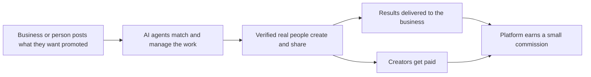

  
  
  
  

---

## 🌍 What I do - in plain English

I build software where **AI "agents"** (think of them as tireless digital team members) do the repetitive work, so a very small team - even one person - can run something big.

I focus on **businesses that earn money**, not just demos. My approach: find a real problem, **research how the best companies solved it**, build the simplest version that can earn revenue, then **scale it** to reach as many people as possible.

| I build | In plain English | Why it matters |
|---|---|---|
| 🤖 **AI agents and agent teams** | Digital workers that research, write, sell, support customers and follow up on their own | One person can do the work of a whole department |
| 🛒 **Marketplaces** | Platforms that match people who need something with people who can do it | Both sides win, and the platform earns a small commission only when a deal happens |
| 📈 **Products that scale** | Systems designed from day one to serve thousands, then millions, of users | Growth without costs growing at the same speed |

---

## 🚀 What I'm building now

### 🛒 Openapp - a growth marketplace *(in development)*

Businesses, startups and individuals post what they want to promote. **Real, verified people** create content and share it on their **own real accounts** - no bots, no fake accounts. AI agents handle the busywork so each side gets things done in a few clicks.

**How it makes money:** a small commission from both sides, so the platform only earns when its users succeed.

### 🏭 An AI-agent agency

A services business run by a "software factory" of AI agents. Each client gets their own isolated workspace, and the agents handle research, building, outreach and reporting while I supervise. The goal: a one-person company that delivers like a large one.

### 🧠 My own agentic development framework

A setup where teams of AI agents plan, build, review and ship software together - faster and cheaper than a conventional team.

---

## 🔬 How I work

- **Research first.** Before building, I study how the best companies and marketplaces were built - and where they went wrong - so I don't repeat their mistakes.
- **Revenue first.** Every idea gets a clear answer to "who pays, how much, and why?" before it gets code.
- **Built to scale.** I build on proven tools instead of reinventing them, and design for volume from the start.
- **Plain language.** If I can't explain a product to a non-technical person in one minute, it isn't ready.

---

## 👋 About me

- 🎓 **IIT Bombay** - BTech Aerospace Engineering · **Middlesex University** - MS Digital Marketing
- 💼 Full stack engineer and former **CTO** - spent years building an edtech platform at **PiAcademy Tutors** (London)
- 🏸 Competitive badminton player · 🧘 daily yoga · 📚 lifelong learner (and I still teach maths)
- 📍 Based in **London**, UK
- 🤝 **Open to new opportunities** - full stack, AI engineering, founding-engineer roles

---

## 🛠️ Tech stack

**Languages**

 

**Frontend**

 

**Backend and data**

 

**Cloud and tooling**

 

**AI and agents**

---

## 📂 Public projects

| Project | What it does | Stack |
|---|---|---|
| 🚌 **[SixthSense](https://github.com/Dinesh-Sunny/sixthsense)** | A video AI agent for bus safety: predicts what happens next in bus-camera footage, checks its own prediction against the next clip, and flags near misses for safety teams. | Python · FastAPI · Next.js · YOLO11 · NVIDIA Cosmos |
| ✂️ **[Jev Token Saver](https://github.com/Dinesh-Sunny/jev-tokensaver)** | Helps AI assistants read only the relevant parts of long logs and files, cutting cost and noise. | Python · MCP · CLI |
| 👥 **[Superteams](https://github.com/Dinesh-Sunny/superteams)** | Multi-tenant team workspace for small agencies, with AI agents built in. | Next.js · TypeScript |
| ⚡ **[Next.js Agent Starter](https://github.com/Dinesh-Sunny/nextjs-agent-starter)** | Starter kit for apps with AI agents built in, with secrets management and AI-provider switching. | Next.js · TypeScript · Tailwind |
| 🧰 **[New App (Claude project starter)](https://github.com/Dinesh-Sunny/new-app)** | Project starter with a full Claude Code setup and a self-maintaining AI-context system. | Claude Code · pnpm · uv |

Most of my current work (Openapp, agency tooling, trading research, education products) is in private repositories.

---

## 📊 GitHub stats

### 📈 Contribution activity

### 🐍 Contribution snake

  <picture>
    <source media="(prefers-color-scheme: dark)" srcset="https://raw.githubusercontent.com/Dinesh-Sunny/Dinesh-Sunny/output/github-snake-dark.svg" />
    <source media="(prefers-color-scheme: light)" srcset="https://raw.githubusercontent.com/Dinesh-Sunny/Dinesh-Sunny/output/github-snake.svg" />
    
  </picture>

---

## 🎯 Currently

- 🔭 Designing **Openapp** foundations - learning from the best marketplaces before writing the first line of production code
- 🤖 Building **agent-run companies**: sales, support and follow-ups handled by AI agents, with me setting direction
- 🌱 Exploring **video agents**, **AI filmmaking pipelines** and **personal AI tutors**
- 💬 Ask me about: marketplaces, AI agents, revenue models, scaling products, Next.js, TypeScript, PostgreSQL

---

## 🤝 Let's connect

Always up for a chat about marketplaces, AI agents and turning ideas into products people pay for.

  

