<!-- Design: Hark-inspired system from github.com/Dinesh-Sunny/sixthsense (docs/design). Artwork is built by design/build.py -->

<a href="https://dinesh-potluru.vercel.app"><picture><source media="(prefers-color-scheme: dark)" srcset="./assets/hero-dark.svg" /></picture></a>

  <a href="https://dinesh-potluru.vercel.app"><picture><source media="(prefers-color-scheme: dark)" srcset="./assets/link-portfolio-dark.svg" /></picture></a>
  <a href="https://www.linkedin.com/in/dinesh-potluru-a967866a"><picture><source media="(prefers-color-scheme: dark)" srcset="./assets/link-linkedin-dark.svg" /></picture></a>
  <a href="https://twitter.com/_dineshsunny"><picture><source media="(prefers-color-scheme: dark)" srcset="./assets/link-x-dark.svg" /></picture></a>
  <a href="mailto:dineshiitb.ae18@gmail.com"><picture><source media="(prefers-color-scheme: dark)" srcset="./assets/link-email-dark.svg" /></picture></a>

 

<picture><source media="(prefers-color-scheme: dark)" srcset="./assets/section-01-dark.svg" /></picture>

I'm an **Applied AI engineer** in London. I've spent the last nine years as CTO and full stack engineer at an edtech company, and now I put AI agents into products that real people use: internal tools, customer-facing assistants and the plumbing that keeps them honest.

My favourite part of the job is the bit before the code. I sit with the people who have the problem, work out what's actually going wrong, then ship the smallest agent that fixes it, with evals so we know it works.

- **Forward deployed by nature** - discovery calls, workshops and specs are as much my job as the code
- **End to end** - architecture, data, frontend, infra and leading the team that runs it
- **Fast** - regular at London AI hackathons, idea to working demo in a weekend
- **Open to** Applied AI, Forward Deployed, AI Solutions and Founding AI Engineer roles
 

<picture><source media="(prefers-color-scheme: dark)" srcset="./assets/section-02-dark.svg" />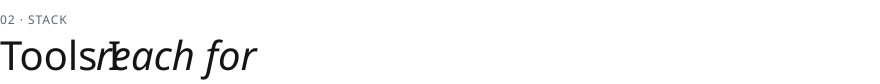</picture>

<picture><source media="(prefers-color-scheme: dark)" srcset="./assets/stack-dark.svg" />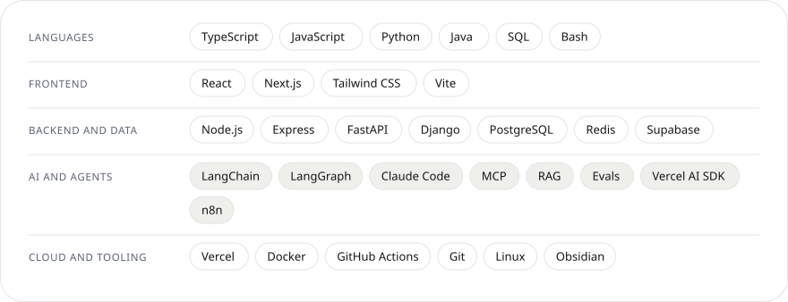</picture>
 

<picture><source media="(prefers-color-scheme: dark)" srcset="./assets/section-03-dark.svg" /></picture>

  <a href="https://github.com/Dinesh-Sunny/sixthsense"><picture><source media="(prefers-color-scheme: dark)" srcset="./assets/project-sixthsense-dark.svg" />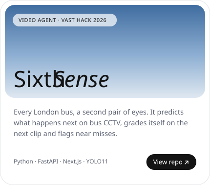</picture></a>
  <a href="https://github.com/Dinesh-Sunny/jev-tokensaver"><picture><source media="(prefers-color-scheme: dark)" srcset="./assets/project-jev-tokensaver-dark.svg" />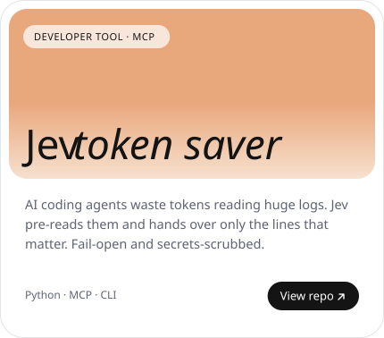</picture></a>

  <a href="https://github.com/Dinesh-Sunny/superteams"><picture><source media="(prefers-color-scheme: dark)" srcset="./assets/project-superteams-dark.svg" />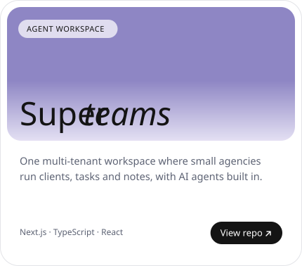</picture></a>
  <a href="https://github.com/Dinesh-Sunny/nextjs-agent-starter"><picture><source media="(prefers-color-scheme: dark)" srcset="./assets/project-nextjs-agent-starter-dark.svg" />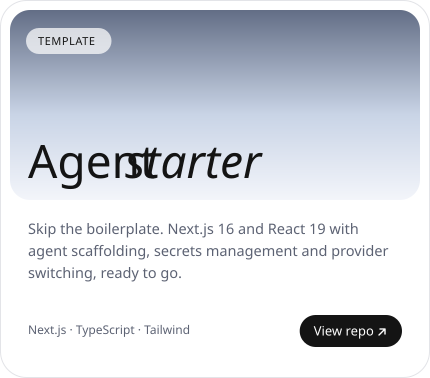</picture></a>

Also on GitHub: **[Claude project starter](https://github.com/Dinesh-Sunny/new-app)** (a repo template with a full Claude Code setup and a self-maintaining AI-context system) and **[Smart Audio Technologies](https://github.com/Dinesh-Sunny/Smart-Audio-Technologies)** (a Next.js business site). More work - agency tooling, trading research, education products - lives in private repos, and I'm happy to walk through it on a call.
 

<picture><source media="(prefers-color-scheme: dark)" srcset="./assets/section-04-dark.svg" />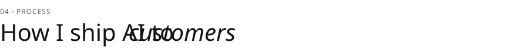</picture>

<picture><source media="(prefers-color-scheme: dark)" srcset="./assets/ship-dark.svg" />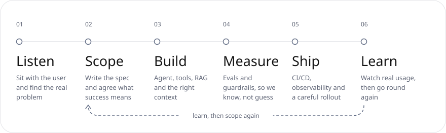</picture>
 

<picture><source media="(prefers-color-scheme: dark)" srcset="./assets/section-05-dark.svg" /></picture>

<picture><source media="(prefers-color-scheme: dark)" srcset="./assets/journey-dark.svg" />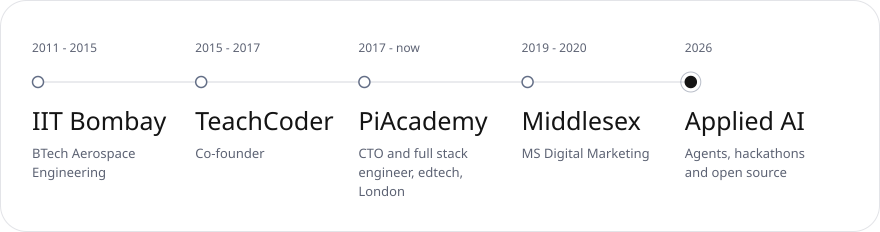</picture>
 

<picture><source media="(prefers-color-scheme: dark)" srcset="./assets/section-06-dark.svg" /></picture>

  <picture><source media="(prefers-color-scheme: dark)" srcset="./profile/stats-dark.svg" /></picture>
  <picture><source media="(prefers-color-scheme: dark)" srcset="./profile/top-langs-dark.svg" /></picture>

  <picture><source media="(prefers-color-scheme: dark)" srcset="https://streak-stats.demolab.com?user=Dinesh-Sunny&background=17181B&border=2A2C33&stroke=2A2C33&ring=8994AA&fire=8FB0D3&currStreakNum=F3F4F6&sideNums=F3F4F6&currStreakLabel=F3F4F6&sideLabels=9AA2B4&dates=9AA2B4&border_radius=14" /></picture>

<picture>
  <source media="(prefers-color-scheme: dark)" srcset="./profile-3d-contrib/profile-hark-dark.svg" />
  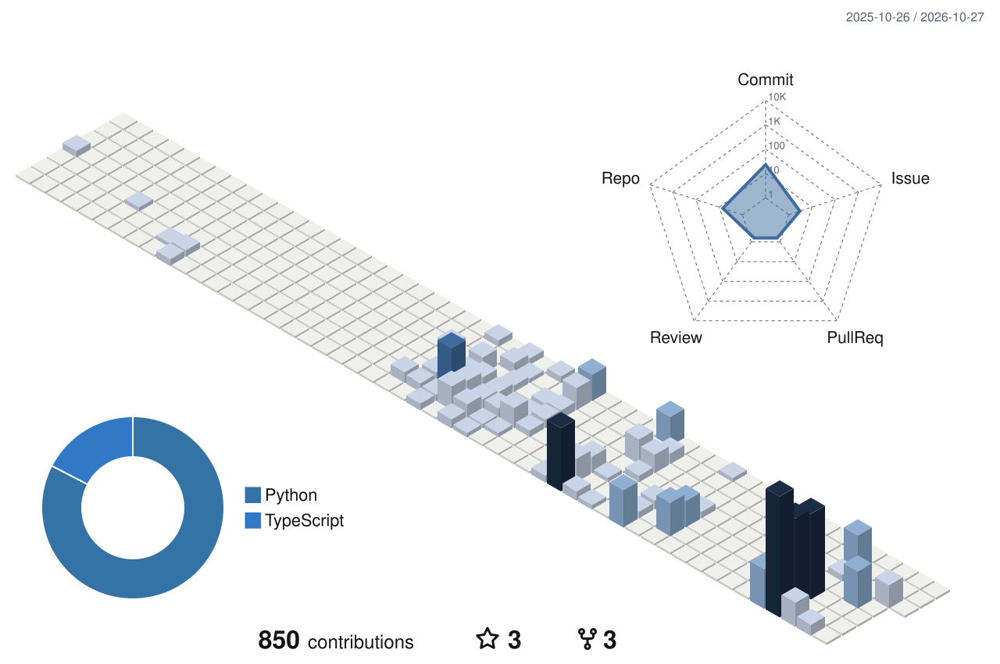
</picture>

<picture>
  <source media="(prefers-color-scheme: dark)" srcset="https://raw.githubusercontent.com/Dinesh-Sunny/Dinesh-Sunny/output/github-snake-dark.svg" />
  
</picture>
 

<picture><source media="(prefers-color-scheme: dark)" srcset="./assets/section-07-dark.svg" /></picture>

<!--START_SECTION:activity-->
1. Pushed to [sixthsense](https://github.com/Dinesh-Sunny/sixthsense) 17 Oct 2026
<!--END_SECTION:activity-->

Updated automatically every few hours.

**Right now**

- Building **agentic dev workflows** - teams of AI agents that plan, code, review and ship
- Exploring **video agents**, **voice AI agents at scale** and **AI filmmaking pipelines**
- Ask me about putting agents into production, RAG and evals, Next.js and TypeScript, Claude Code and hackathons

<b>What I can own end to end</b>

 

| Area | What that looks like |
|---|---|
| Discovery | Workshops with users and stakeholders, turning vague asks into scoped specs |
| AI engineering | Agents, tool calling, RAG pipelines, prompt and context engineering, evals |
| Product engineering | Next.js and React frontends, Node.js and Python APIs, PostgreSQL and Redis |
| Delivery | CI/CD, GitHub Actions, Vercel, Docker, observability |
| Leadership | Leading DX and AI engineering teams, code review, mentoring |

 

<a href="mailto:dineshiitb.ae18@gmail.com"><picture><source media="(prefers-color-scheme: dark)" srcset="./assets/footer-dark.svg" />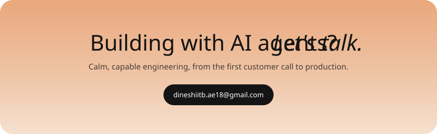</picture></a>

